# YNAB Unlinked

`yul` is a companion for [YNAB](https://www.ynab.com) that runs on your computer. It does two
things:

- **Imports every statement at once.** YNAB imports one file into one account at a time, and
  only in the formats it knows (CSV, OFX, QFX, QIF). yul understands the exports of specific
  banks, PDFs and web pages included: drop every file you downloaded, yul works out which bank
  each one is and sends its transactions to the right account, skipping what YNAB already has.
  It also reconciles against what your bank says, and lets you set by hand the balance of
  accounts that have no statement at all, like investments, a pension or shares.
- **Shows you what your budget data means.** From a local copy of your budget: how your net
  worth moved each month and why, which accounts grow and which lose, what you earn, spend and
  save, which categories take most of your money and how steady or swingy each one is.

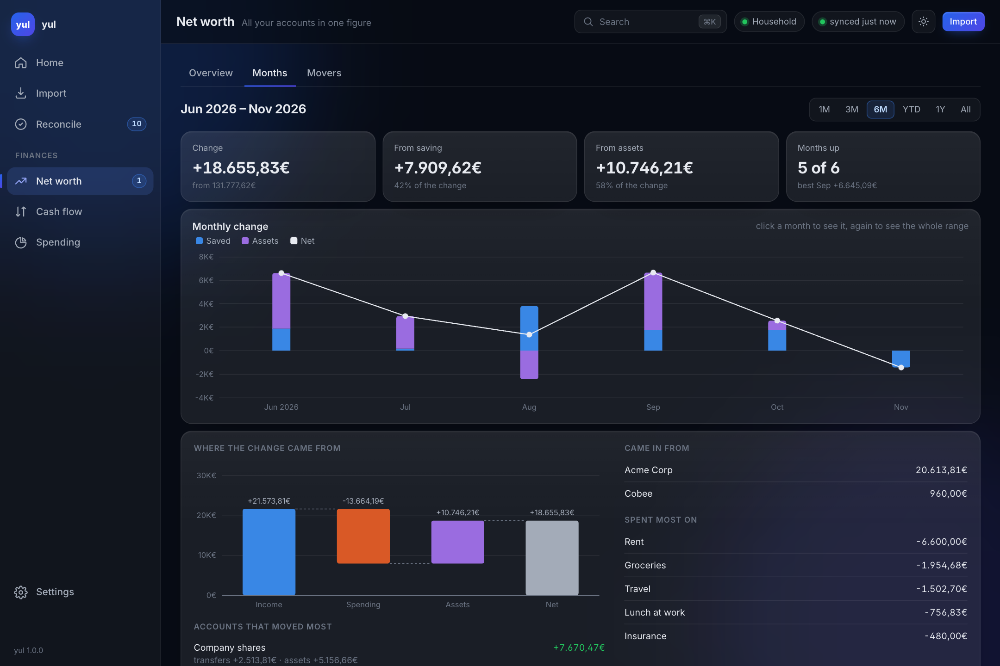

## Supported banks

| Bank | What to download | Formats |
|---|---|---|
| BBVA | Credit card statement | PDF, XLSX |
| Sabadell | Card movements | TXT, XLS |
| Cobee | The transactions page, saved from the browser | HTML |

Is your bank missing? [Open an issue](https://github.com/AAraKKe/ynab-unlinked/issues/new) with
its name and the kind of file it lets you download, or add it yourself: a bank is a small Python
package, see the [wiki](https://github.com/AAraKKe/ynab-unlinked/wiki).

## Get started

1. **Install it.** Python 3.13 or newer, on macOS or Linux. The recommended way is
   [uv](https://docs.astral.sh/uv/):

   ```sh
   uv tool install 'ynab-unlinked[web]'   # the app and the command line
   uv tool install ynab-unlinked          # the command line only
   ```

   `pip install 'ynab-unlinked[web]'` works too. Upgrade with `uv tool upgrade ynab-unlinked`,
   or from the app: when a newer version is out an **Update** button shows next to the version
   in the sidebar, and a click updates yul and restarts it.

2. **Create a YNAB token.** Open
   [app.ynab.com/settings/developer](https://app.ynab.com/settings/developer) (in YNAB:
   Account Settings, then Developer Settings), click **New Token** and copy it. YNAB shows it
   only once.

3. **Run it.**

   ```sh
   yul app
   ```

   The app opens in your browser. The first run asks for the token (kept in your system
   keychain, not in a file), lets you pick the budget and where each bank's statements go, then
   copies the budget to your computer.

## The app

The app runs only on your computer. It works from a local copy of your budget, so every page
is instant, and it syncs with YNAB on its own while it is open and after every change it makes.

- **Home**: your net worth, what needs you today, a place to drop statements, and the month
  so far: what came in and went out against a usual month, and where it went.

  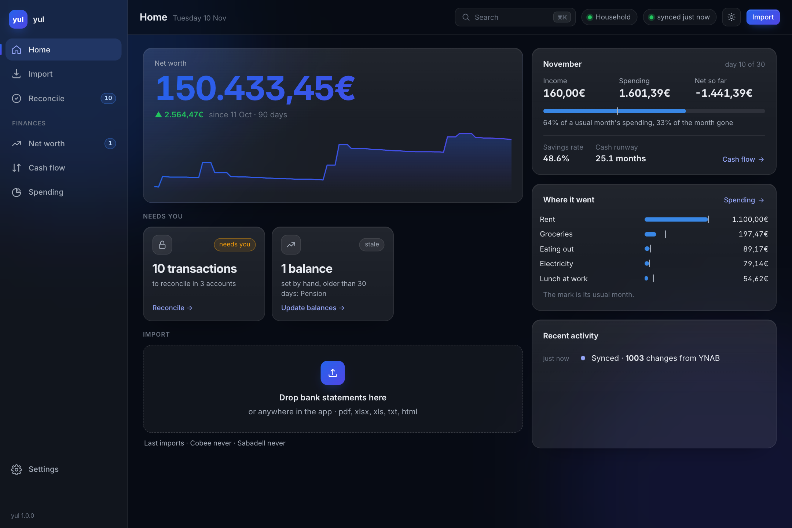

- **Import**: drop one or more statements anywhere; `yul` works out the bank, shows what is new
  and imports it after one confirmation.

  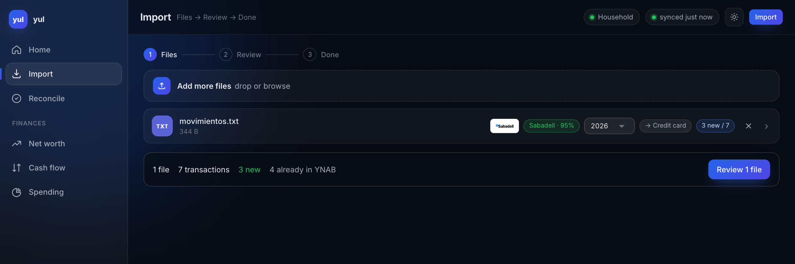

- **Reconcile**: type what your bank says, see the gap, reconcile the cleared transactions.

  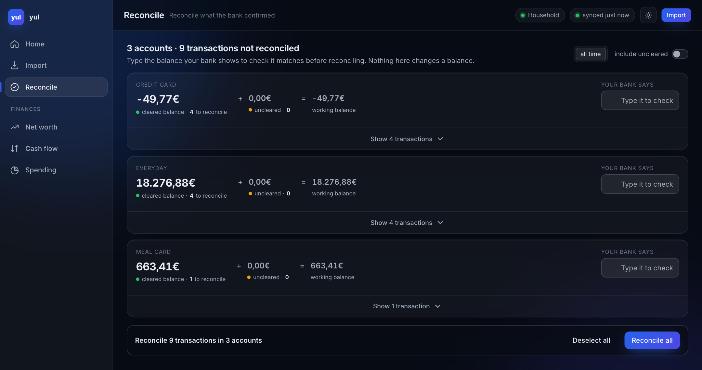

**Finances**

- **Net worth**
  - *Overview*: history by total, type or account, and the balances you update by hand.

    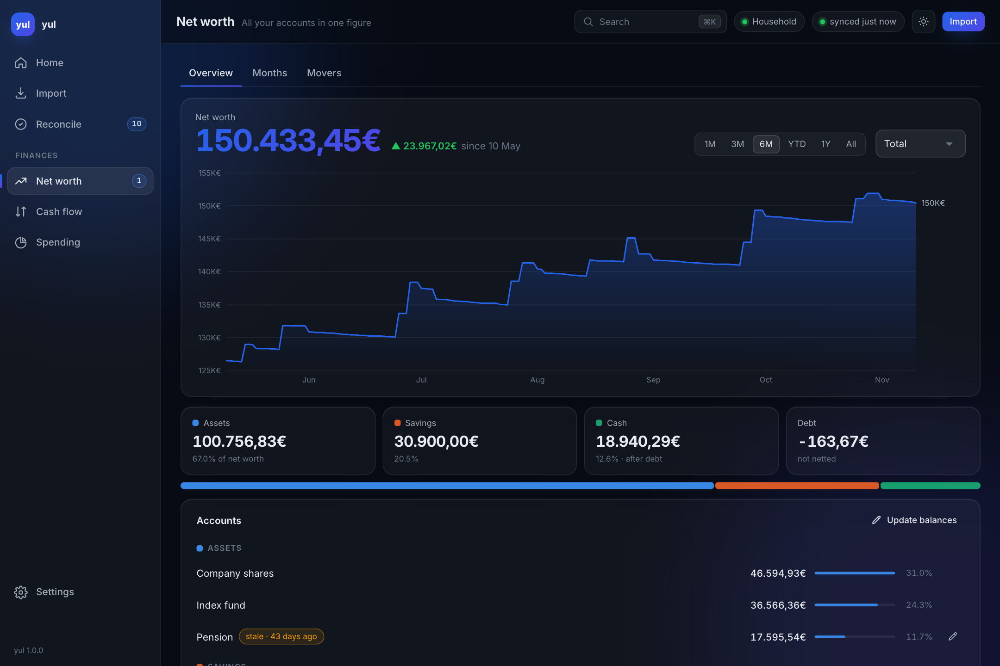

  - *Months*: how much net worth moved each month, split into what you saved, what your assets
    did and the rest. Pick a month, or the whole range, to see where the change came from,
    which accounts moved and why, what came in and what went out (the picture at the top).
  - *Movers*: every account's change, what you put in or took out, what it did on its own, and
    its return.

    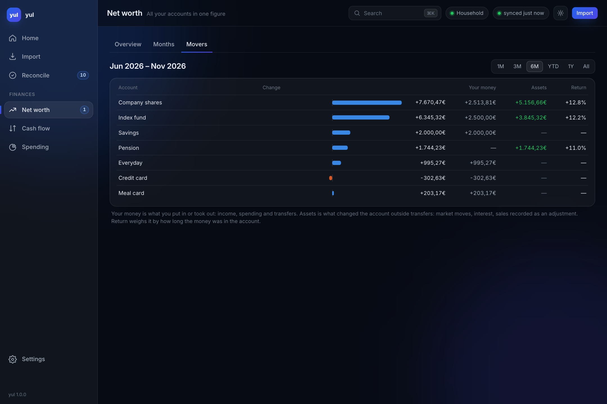

- **Cash flow**: income against spending month by month, your savings rate, how many months
  your cash would last, and where your income comes from.

  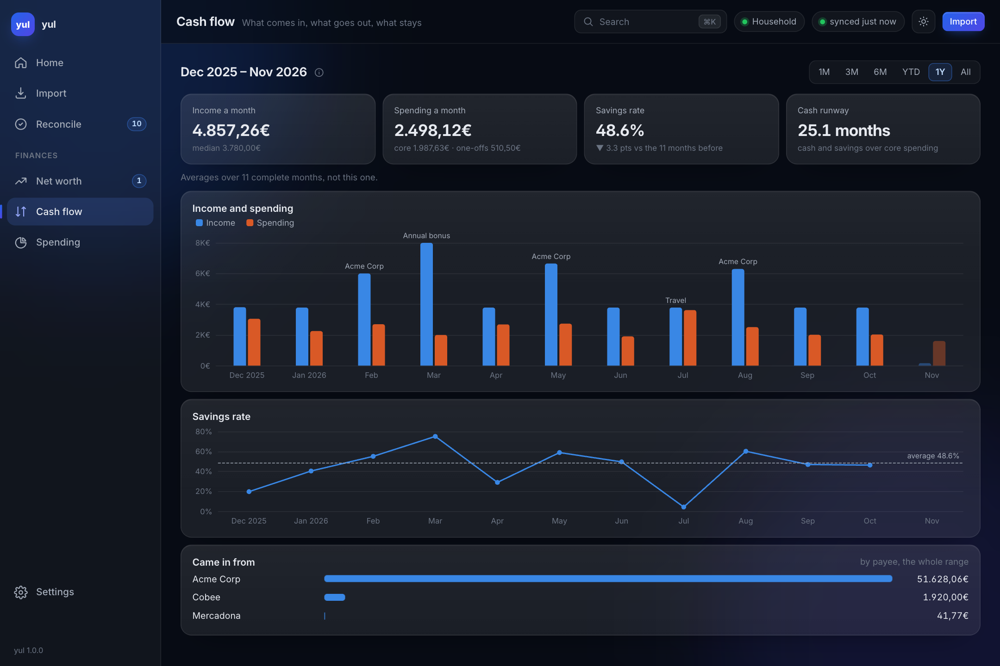

- **Spending**: by group and by category, and how each category moves: steady, variable,
  spiky (it keeps coming, and some months are far bigger), or lumpy (nothing most months, then
  an expense, like a yearly subscription or a repair). Click a category to see its months and
  how they spread.

  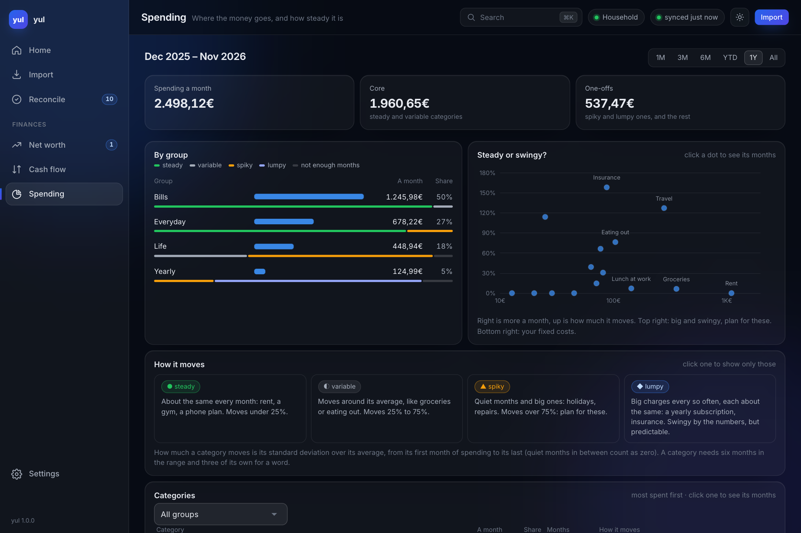
  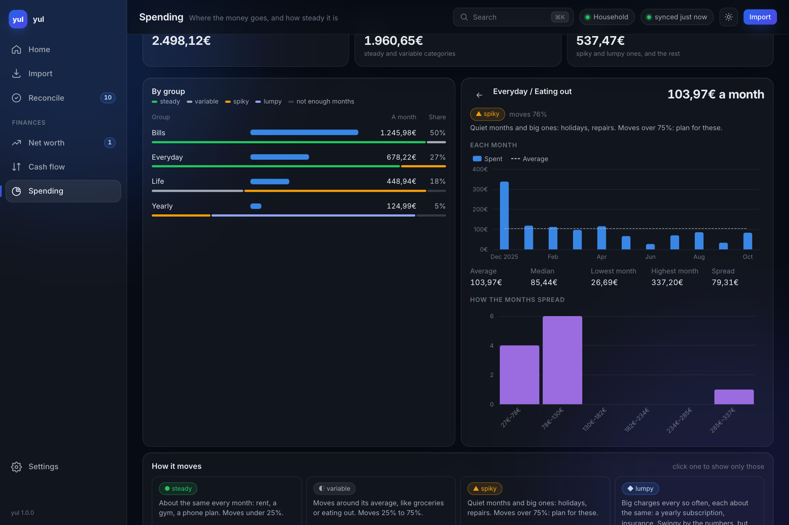

- **Plan**: where your net worth is heading. It starts from what your last months measured
  (what comes in, what you spend, where your saving goes, what your assets return) and lets
  you move any of it to see another future, next to the one you are on. It also says when the
  category you are saving in reaches its target.

  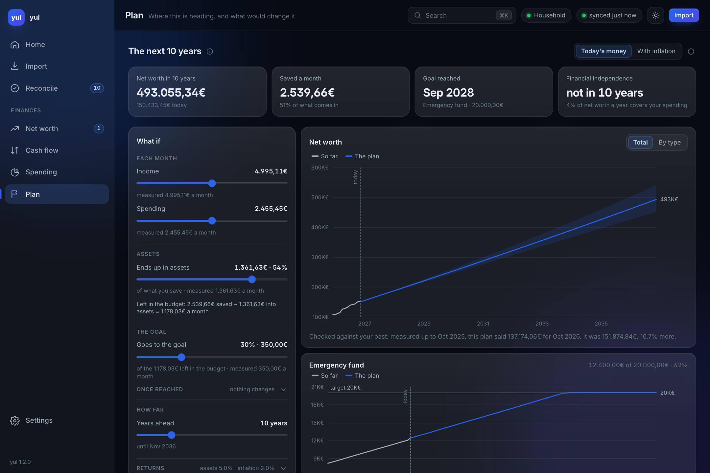

**Search**: press ⌘K (Ctrl+K, or `/`) anywhere to jump to a page, a Settings tab, a category
or an account, or to sync or switch between light and dark.

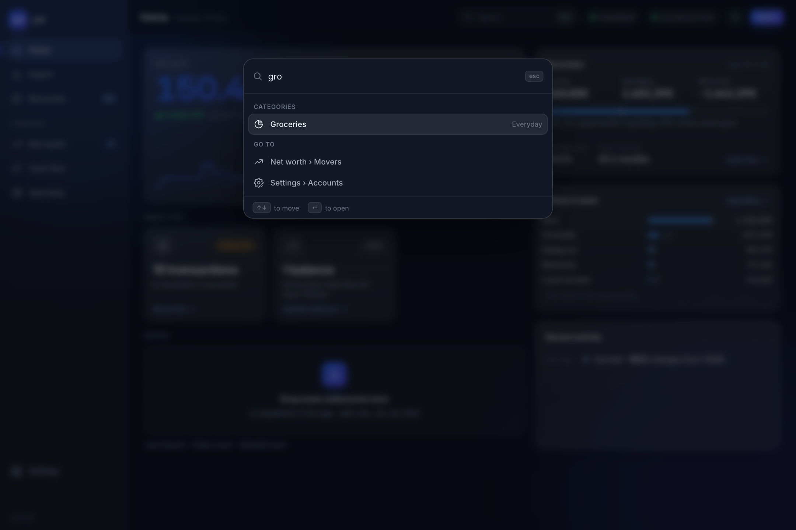

The sidebar counts what is waiting for you (transactions to reconcile, balances to update),
and the app works in a phone-sized window too.

**Settings**: the connection, the banks, which accounts count in your net worth and in which
group, whose return to follow, the goal, the categories that are not spending, the look, and
your local data.

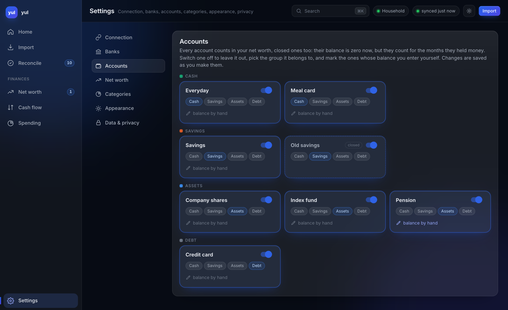

The screenshots show a made-up budget; `scripts/readme_screenshots.py` takes them again.

### How yul reads your money

Every transaction counts once, so the parts always add up to the change of net worth:

- **Income** is money that comes into an account on your budget, whatever its category.
  Refunds count too: they raise income and spending by the same amount.
- **Spending** is money that leaves an account on your budget, unless it goes to another of
  your accounts or its category is marked as not spending.
- **Assets** is what a tracking account (investments, shares, a pension) does on its own:
  market moves, interest, a sale recorded as an adjustment.
- **Transfers** between your accounts move nothing. Closed accounts count for the months they
  held money.

To get the most out of it, record a share vest as a split in the account your salary lands in
(the shares as income, then a transfer to the shares account) and a sale as a transfer to where
the money lands. Then income is your pay and the shares account only shows what the shares did.

## Command line

```sh
yul load auto ~/Downloads/movimientos.txt ~/Downloads/Cobee.html   # detects the bank of each file
yul load sabadell movimientos.txt                                  # or name the bank
yul load bbva --help                                               # options of one bank
yul reconcile                                                      # reconcile cleared transactions
yul config show                                                    # where things go
yul privacy                                                        # what is stored on this computer
```

The first command runs setup if there is no configuration yet. `yul load` shows every
transaction it is about to create and asks once before importing; add `--yes` to run it
unattended.

Send each bank to its own YNAB account. yul recognises what it already imported the way YNAB's
own file import does, by date, amount and how many times that pair repeats, without the bank.
Two banks feeding one account can then take a row of the same day and amount, imported in
separate runs, for one already in YNAB and skip it.

A row tagged "may be in YNAB" is held back: it has the amount of a transaction you entered by
hand and matched in YNAB with an earlier import yul can no longer name. In the app's review
choose "Import anyway" or "Leave out"; `yul load` names those rows and does not send them.

## Privacy

Everything runs on your computer and your data only goes to YNAB's API. The app also asks
PyPI once a day whether a newer yul is out, which sends nothing about you and can be turned
off in Settings › Data & privacy. There is no telemetry. The copy of your budget stays on your computer. Your token lives in the system
keychain (macOS Keychain, Windows Credential Manager, Secret Service or KWallet on Linux).
`yul privacy` lists what is stored and where, `yul config reset` deletes all of it, and the
[privacy notice](./PRIVACY.md) has the details.

## Disclaimer

We are not affiliated, associated, or in any way officially connected with YNAB or any of its
subsidiaries or affiliates. The names "YNAB" and "You Need A Budget" are trademarks of their
respective owners.

## License

`ynab-unlinked` is distributed under the terms of the [MIT](https://spdx.org/licenses/MIT.html)
license.
